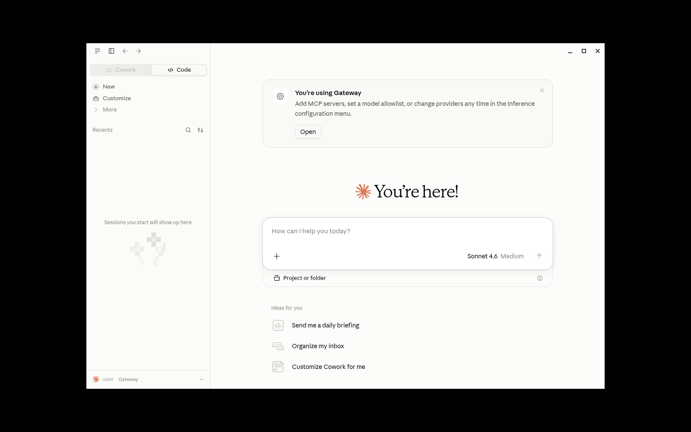
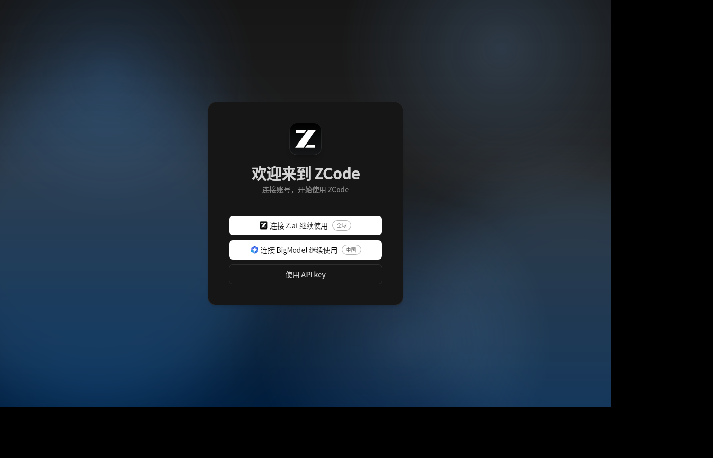

# LoongArch Agent Toolkit

Practical tools for running AI coding agents on **LoongArch (loongarch64)**
Linux, built and verified on Loongnix 6.6.52 with ABI2.0 userspace.

## Binary distribution

Public installers download the reviewed binaries from this repository's
[`agent-binaries`](https://github.com/yunix-intel/loongarch-agent-toolkit/releases/tag/agent-binaries)
release. The build source repositories (`loongarch-agent-builds` and
`cc-switch-loongarch`) are private; their reviewed assets are mirrored here.
`install/versions.env` points only at this public mirror, and no token is
needed to install. When a new build is added, mirror the asset to
`agent-binaries` first: the version watch refuses to move a public pin to a
missing mirror asset.

This repository collects three pieces of work:

Security policy: [`SECURITY.md`](SECURITY.md).

| Component | What it is | Status |
| --- | --- | --- |
| [`ccswitch-lite/`](ccswitch-lite/) | Single-binary Go CLI + Web UI for switching Claude Desktop / Claude Code / Codex between private gateways | Working; 86 acceptance assertions pass |
| [`zcode-tauri/`](zcode-tauri/) | Lightweight Tauri 2 shell around the ZCode Web UI | Working; release binary and `.deb` built |
| [`install/`](install/) | Installers for ABI2.0 Node, `codex`, `opencode`, `dsh`, Claude Code, ZCode and cc-switch | Working; native CLIs, ZCode TUI, Claude Code 2.1.112 and cc-switch deb installers |

`zcode-tauri/` and the private build repository's
`vendor/zcode-tauri` share the same source files; only the packaging variants
differ. Check the invariant with
`scripts/check-zcode-tauri-sync.sh <private-builds-checkout>`.

The official [`farion1231/cc-switch`](https://github.com/farion1231/cc-switch)
Tauri app **has been built for loongarch64**: upstream v4.0.19 compiles with
Rust 1.97.1 and its full UI has been verified under Xvfb. The build source is
the private `yunix-intel/cc-switch-loongarch` repository; the reviewed deb is
mirrored in this toolkit's public
[`agent-binaries`](https://github.com/yunix-intel/loongarch-agent-toolkit/releases/tag/agent-binaries)
release. Build details are in
[`docs/cc-switch-loongarch.md`](docs/cc-switch-loongarch.md). `ccswitch-lite`
remains a lighter single-binary alternative.



## Repository layout

```text
ccswitch-lite/          Go source, embedded Web UI, tests/
zcode-tauri/            Tauri 2 source, frontend loading page, packaging
install/                Agent installer + reference wrappers
docs/                   ABI/Node, cc-switch port, Tauri, screenshots
.github/workflows/      ccswitch-lite build + shellcheck CI, agent version watch
```

## Prerequisites

- LoongArch Linux, ABI2.0 userspace (`e_flags 0x43`). Check with
  `LC_ALL=C readelf -h /bin/ls | grep Flags`.
- Go 1.24+ for `ccswitch-lite`.
- Rust 1.85+, GTK 3 and WebKitGTK 4.1 development packages for `zcode-tauri`.
- Root access for the installer (it writes `/opt` and `/usr/local/bin`).
- `curl`, `xz`, `python3` (3.11+ for the acceptance test), `bash`.
- For `install-claude-code-loongarch.sh`: `npm` next to the selected Node
  runtime (Loongnix ships npm separately from the `node` package); the script
  now finds `/opt/node24/bin/npm` even when `/usr/bin/npm` is absent.
- For `dsh`: a C/C++ toolchain (`gcc`, `g++`, `make`, `python3`) and HTTPS
  access to `unofficial-builds.nodejs.org`, because node-pty is built locally
  when no loong64 prebuild exists. The installer retries once.
- For GUI smoke tests: `xvfb`; for local version-watch runs: `gh` plus a token
  with access to the repositories.

## ccswitch-lite

A stdlib-only Go program that manages gateway profiles and writes:

1. Claude Desktop 3P config (`~/.config/Claude*` + `configLibrary`);
2. Claude Code `~/.claude/settings.json` env keys;
3. Codex `~/.codex/config.toml` and `auth.json`.

Build and run:

```sh
cd ccswitch-lite
CGO_ENABLED=0 GOOS=linux GOARCH=loong64 \
  go build -trimpath -ldflags "-s -w" -o ccswitch-lite .
./ccswitch-lite add --name gw --base-url https://api.example.com \
  --api-key sk-xxxx --format anthropic
./ccswitch-lite use gw
./ccswitch-lite list
./ccswitch-lite restore
./ccswitch-lite web            # http://127.0.0.1:18081/
```

`baseUrl` must **not** include `/v1`: Claude Desktop appends `/v1/messages`.
API keys are stored in a 0600 `providers.json`, shown only masked, and the Web
UI refuses non-loopback bind addresses.

Acceptance test (throwaway `HOME`, never touches real configs):

```sh
cd ccswitch-lite
bash tests/test.sh
```

Tests use `python3` with `tomllib`, plus `curl` and `sha256sum`. See
[`ccswitch-lite/README.md`](ccswitch-lite/README.md) for the full config
schema and restore semantics.

## zcode-tauri

Tauri 2 shell that starts `zcode --web --no-open`, parses the loopback URL from
stdout, and shows it in a WebKitGTK window. It stops only the process group it
created.

```sh
cd zcode-tauri
python3 packaging/gen_icons.py                 # if icons are missing
cargo build --release --manifest-path src-tauri/Cargo.toml
sh packaging/build-deb.sh                      # optional .deb/.tar.gz
```

Runtime environment variables: `ZCODE_BIN`, `ZCODE_WEB_URL`,
`ZCODE_TAURI_LOG`, and `ZCODE_TAURI_SOFTWARE_GL=1` (Mesa llvmpipe under Xvfb).
See [`docs/tauri-loongarch.md`](docs/tauri-loongarch.md).



## Installing codex / opencode / dsh

```sh
sudo ./install/install-loongarch-agents.sh
```

The installer:

- detects ABI from ELF `e_flags` (`0x3` = ABI1.0, `0x43` = ABI2.0);
- downloads Node **22.23.3** from `loong64/node` (not the ABI1.0 Loongnix FTP
  22.16 tarball) into `/opt/node22-abi2`;
- installs `opencode-ai` and `@deepseek-ai/dsh` at the versions in
  [`install/versions.env`](install/versions.env) from
  `https://registry.loongnix.cn:5873`;
- installs Codex from either the npm channel (`@openai/codex`) or a local
  source-build tarball, selected by `CODEX_CHANNEL`;
- writes `/usr/local/bin/{codex,dsh,opencode}` wrappers (the source channel
  writes `codex-<version>` unless `CODEX_LINK_DEFAULT=1`).

[`install/versions.env`](install/versions.env) is the **single source of
truth** for every pinned version. The installer reads it at runtime, and the
README table below is generated/checked against it (CI fails on drift).
Environment variables (`NODE_VERSION`, `CODEX_VERSION`, `OPENCODE_VERSION`,
`DSH_VERSION`, `VERSIONS_FILE`) still override the manifest; `NODE_PREFIX`
overrides the install prefix. The system Node is untouched.

<!-- agent-versions:begin -->
| 工具 | selected | 说明 |
| --- | --- | --- |
| Node.js | `22.23.3` | ABI2.0 运行时，来自 `loong64/node` |
| Codex | `0.164.0` | 龙芯 loong64 可用最新版（非上游 latest） |
| Codex (source) | `0.164.0` | 私有 builds 仓库的 LoongArch 源码构建（可选通道） |
| OpenCode | `1.19.0` | `opencode-linux-loong64` 最新版 |
| DSH | `0.2.1-rc.2` | Loongnix registry 最新版 |
| Claude Code | `2.1.112` | 最后一个 npm tarball 仍带 `cli.js` 的版本 |
| ZCode | `v3.15.1` | builds 仓库中资产齐全的最新 release（tag 仅作 upstream） |
| cc-switch | `v4.0.21` | 私有 builds 仓库中最新的 loong64 deb release |
<!-- agent-versions:end -->

`selected` 的含义是“当前龙芯上可用的最新版”，不一定是上游 latest。版本
选择规则、Claude Code native-only 的处理，以及 ZCode / cc-switch 为什么跟
已构建的 release 而不是上游 tag，见
[`docs/version-policy.md`](docs/version-policy.md)。

### Codex: npm vs source

`CODEX_CHANNEL=npm`（默认）安装 Loongnix registry 的
`@openai/codex@CODEX_VERSION` 并写默认 `codex`。`CODEX_CHANNEL=source` 则把
源码构建包解到 `/opt/codex-<CODEX_SOURCE_VERSION>`，写
`/usr/local/bin/codex-<version>`；除非 `CODEX_LINK_DEFAULT=1`，**不会覆盖**
默认 `codex`。

```sh
# 默认读取 install/versions.env 的 source 版本/URL/SHA256
# （0.164.0，asset 668589231，SHA256 55b9bbcc…a75e09）。
read -r -s -p 'GitHub token: ' CODEX_SOURCE_TOKEN; echo
export CODEX_SOURCE_TOKEN
sudo -E CODEX_CHANNEL=source ./install/install-loongarch-agents.sh
unset CODEX_SOURCE_TOKEN
```

`CODEX_SOURCE_URL` 支持 `http(s)://` 或本地 `.tar.gz`；使用本地归档时再显式
覆盖为 `CODEX_SOURCE_URL=/path/to/codex-rust-v0.164.0-loongarch64.tar.gz`。
公共镜像无需 token；如果显式改用私有 GitHub API asset，可设置
`CODEX_SOURCE_TOKEN`。安装器在解包前校验 SHA-256，并拒绝包含绝对路径、`..`
或可执行入口 symlink 的条目。

### ZCode CLI / desktop

ZCode 的 CLI 与两个 Tauri 桌面 deb 镜像在公共
[`agent-binaries`](https://github.com/yunix-intel/loongarch-agent-toolkit/releases/tag/agent-binaries)
release 中；安装器不需要 token。`install-zcode-loongarch.sh` 支持三种通道：

```sh
# 默认 cli 通道；URL/SHA 已记录在 versions.env。
sudo -E ./install/install-zcode-loongarch.sh

# 显式覆盖资产（适合其他 mirror/release）
sudo -E ZCODE_CHANNEL=cli \
  ZCODE_CLI_URL=https://github.com/yunix-intel/loongarch-agent-toolkit/releases/download/agent-binaries/zcode-cli_3.15.1_loong64.tar.gz \
  ZCODE_CLI_SHA256=6b070c44b1e9fbd6b0040a8f20e39f03a224242f366584655da7a65b29a44cd0 \
  ./install/install-zcode-loongarch.sh

# 轻量 Tauri 桌面（捆绑 CLI，依赖系统 Node >= 24）
sudo -E ZCODE_CHANNEL=desktop ./install/install-zcode-loongarch.sh

# 自带 Node + CLI 的桌面版
sudo -E ZCODE_CHANNEL=standalone ./install/install-zcode-loongarch.sh
```

资产 URL/SHA 也可以写进 `install/versions.env` 的 `ZCODE_*` 字段。
linux-loong64 的 CLI 现在捆绑 native opentui 渲染器（`libopentui.so`）以及
koffi/unsafe-pointer 的 loong64 构建，默认入口启动 TUI；`zcode --web` 仍可用。
构建源在私有 `loongarch-agent-builds`，产物经审核后镜像到上面的公共 release；
构建流程见其 `build-opentui`/`build-cli` job。

### Claude Code（2.1.112 纯 JS 版）

2.1.113 起上游只发 native-only 包，没有 linux-loong64 artifact。安装器固定安装
最后一个带 `cli.js` 的 2.1.112，并关闭自动更新，避免它自己拉成 native-only：

```sh
sudo ./install/install-claude-code-loongarch.sh
```

默认安装到 `/opt/claude-code`，wrapper 为 `/usr/local/bin/claude`，使用
`/opt/node26`（不存在时回退 `/opt/node24`、`/opt/node22-abi2`）。最新的
2.1.305 仍可通过已有的 `qemu-x86_64-static -L /opt/x86_64-root` wrapper
`claude-latest-x64` 使用，不设为默认。

### cc-switch 官方 Tauri 版

官方 cc-switch 的 loong64 deb 镜像在公共 `agent-binaries` release 中：

```sh
sudo -E ./install/install-cc-switch-loongarch.sh
```

安装器校验 deb SHA-256 后通过 apt/dpkg 安装，启动器是 `/usr/bin/cc-switch`。
`ccswitch-lite` 的 `/usr/local/bin/ccswitch` 不受影响，两者可以并存。
资产 URL/SHA 在 `install/versions.env` 的 `CC_SWITCH_DEB_*` 字段。构建源在私有
`cc-switch-loongarch`；公开用户只需要上面的公共 mirror。

Why ABI matters, and why Node 22.16 silently does nothing for `dsh`, is
documented in [`docs/abi-and-node.md`](docs/abi-and-node.md).

## Private build sources and public mirror

`loongarch-agent-builds` and `cc-switch-loongarch` are private build sources
with self-hosted loong64 runners. Their reviewed assets are copied into this
repository's public `agent-binaries` release; installers never reference the
private releases. The version watch only writes a new URL after the matching
asset exists in `agent-binaries`.

## Dependency refresh

`dependency-refresh.yml` is a manual workflow that refreshes the
`zcode-tauri` Cargo lockfile and opens a PR. It uses `AUTO_ALIGN_TOKEN` for PR
creation because repository policy deliberately blocks `GITHUB_TOKEN` from
creating or approving pull requests. The private build sources use their own
dependency-refresh workflow; public installers are unaffected until a reviewed
asset is mirrored.

## Agent version watch and alignment

[`.github/workflows/agent-version-watch.yml`](.github/workflows/agent-version-watch.yml)
runs daily at 02:17 UTC (and on demand) on GitHub-hosted `ubuntu-latest`, so it
needs no loong64 runner. It reads `install/versions.env`, queries:

- upstream npm `latest` for Codex, OpenCode, DSH and Claude Code;
- Loongnix `loong64` builds (`@openai/codex` `-linux-loong64` versions,
  `opencode-linux-loong64`, `@deepseek-ai/dsh`);
- the Claude Code npm tarball for the newest version that still contains
  `cli.js` (2.1.113+ are native-only);
- `zai-org/ZCode` tags **and** releases (tags are authoritative);
- `farion1231/cc-switch` latest release;
- source-built Codex releases (including drafts) in the private
  `yunix-intel/loongarch-agent-builds` repository when `AUTO_ALIGN_TOKEN` can
  read it; a newer build updates `CODEX_SOURCE_VERSION/URL/SHA256`, while
  `CODEX_CHANNEL` stays `npm` unless changed by hand. The URL is written only
  after the asset exists in the public `agent-binaries` mirror. Without the
  token the issue reports `source build available (private; set AUTO_ALIGN_TOKEN or URL)`
  and the npm pin is not touched.

It then writes a table with `upstream / loong64 可用 / selected / 状态` and
creates or updates the single open issue labeled
[`agent-update`](https://github.com/yunix-intel/loongarch-agent-toolkit/issues?q=label%3Aagent-update).

**Automatic alignment:** when `selected` differs from `install/versions.env`,
the workflow updates the manifest, the installer fallback block and the README
table, pushes to the `auto/version-alignment` branch and opens (or updates a)
pull request whose body lists every change. It never commits to `main`, never
merges, never installs and never publishes. When nothing is selectable it only
updates the issue and opens no PR. Statuses such as
`waiting-for-loong64-port` mean upstream is ahead but no loong64 build exists
yet.

CI also runs `.github/scripts/check-versions-consistency.sh`, which fails if
`versions.env`, the installer fallbacks and the README table disagree.

Trigger it manually and inspect the result:

```sh
gh workflow run agent-version-watch.yml
gh run list --workflow=agent-version-watch.yml --limit 1
gh run view <run-id> --log        # or: gh run view <run-id> --web
```

The step summary (table + status) is on the run page; actionable results are
tracked in the `agent-update` issue, and proposed bumps in the auto-alignment
PR. The branch is validated **before** it is pushed (manifest consistency,
`shellcheck`, `go test` and a loong64 build), so its content does not depend on
extra CI runs.

A PR opened with the default `GITHUB_TOKEN` is authored by
`github-actions[bot]`; GitHub parks its `pull_request` run in
`action_required` (no jobs, no logs) until a maintainer approves, which is not
a content failure. Optionally set a repository secret `AUTO_ALIGN_TOKEN` (a PAT
with contents and pull-request write access) so the branch and PR are created
as that user and CI starts automatically; the token is passed only through the
environment and is never committed. See
[`docs/version-policy.md`](docs/version-policy.md#自动-pr-的-ci-与推送前校验).

## Claude Desktop repack

The historical Claude Desktop repack scripts (ASAR reader, AMO sanity check and
old Debian/AppImage metadata) moved to a separate private Claude Desktop
repository, where the maintained shim and build also live. This toolkit no
longer carries Claude Desktop packaging code.
The old minimal shim that used to live here was removed: it did not reject
`..`/separators or symlinks and could escape the safe-fs root. Not affiliated
with Anthropic.

## Known limitations

- `ccswitch-lite` keeps API keys in plaintext (0600 file), not a keyring.
- Custom headers are written only for Codex; Desktop/Claude Code have no
  corresponding config slot.
- The Web UI has no user authentication; it binds to loopback and now rejects
  non-loopback Host headers, cross-site Origins and non-JSON writes.
- The official cc-switch loong64 port is built from upstream source and ships a
  `.deb`; see
  [`docs/cc-switch-loongarch.md`](docs/cc-switch-loongarch.md). `ccswitch-lite`
  remains the smaller, stdlib-only option.
- Claude Desktop's bundled Claude Code is x86-64, so Code/Cowork cannot run on
  LoongArch.

## Security

This repository intentionally excludes binaries, logs, cookies, package
caches, SSH material and API keys. Example keys in documentation are
placeholders. Do not commit `~/.claude`, `~/.codex`, `providers.json`,
`cookies.txt` or Anthropic application payloads.

## License

Our code is MIT-licensed; see [`LICENSE`](LICENSE). Third-party components
remain under their own licenses; see
[`THIRD_PARTY_NOTICES.md`](THIRD_PARTY_NOTICES.md).
